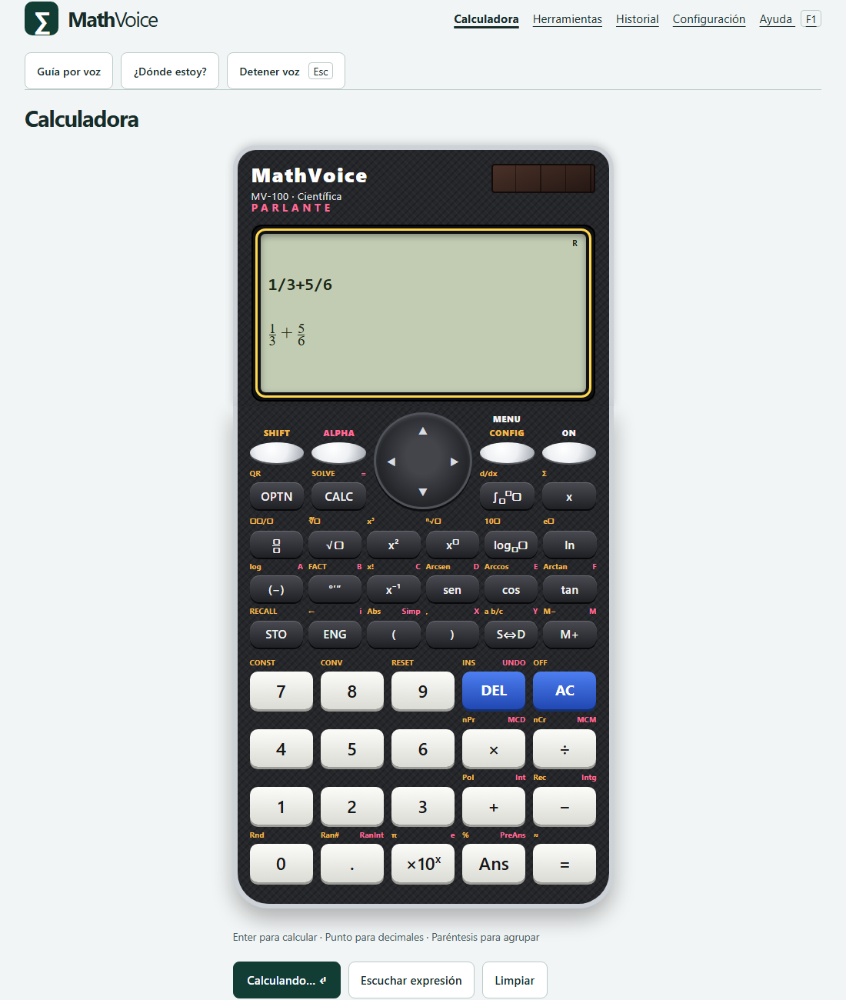
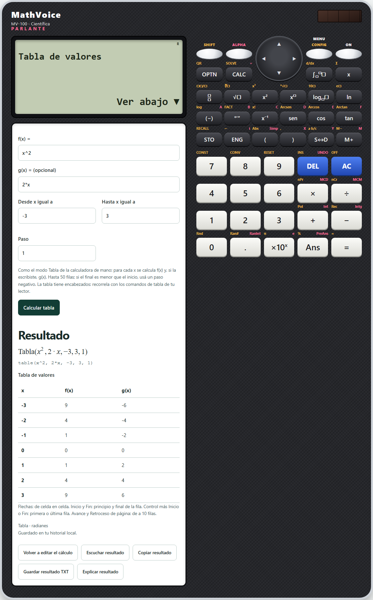
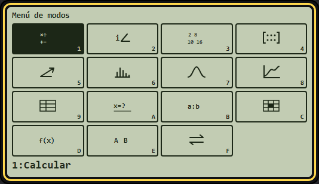
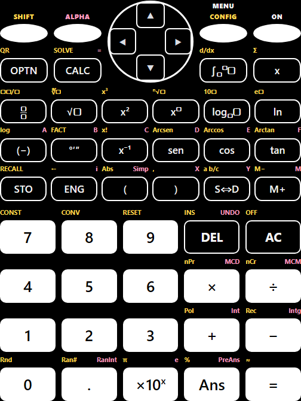

# Qué cambió en MathVoice 0.5

Este documento explica, cosa por cosa, todo lo que se hizo en la rama `mejoras-0-5`: más de treinta cambios, todos subidos a GitHub. Para cada parte dice qué cambió, cómo se usa y por qué importa para alguien que usa la calculadora sin mirar la pantalla. La versión 0.5.0 todavía está en preparación: al final están las pruebas que la respaldan y lo que falta.

Para verla funcionando: `npm install` y después `npm run dev`; se abre en <http://127.0.0.1:5173>.

## 1. La calculadora tiene forma de calculadora científica de mano

**Qué cambió.** La pantalla principal ya no es un formulario con un teclado desplegable: es una calculadora como las Casio ClassWiz. Tiene cuerpo oscuro con borde plateado, marca, panel solar y una pantalla LCD verde donde se ve la expresión escrita, la misma expresión en forma de libro (fracciones, raíces, potencias, ∫, Σ, d/dx) y el resultado alineado a la derecha. Arriba de la pantalla aparecen los indicadores de la calculadora real: S (Shift), A (Alpha), M (memoria), STO, INS, FIX o SCI y el modo angular (R, D o G).

**Cómo se usa.** Cada tecla hace lo mismo que en la calculadora de mano:

- **SHIFT** activa las funciones impresas en dorado y **ALPHA** las letras en rojo; se apagan solas después de una tecla.
- Los números, las operaciones, **Ans**, **=** y **≈** (resultado en decimal). Después de un resultado, un operador sigue la cuenta con Ans y un número empieza una cuenta nueva.
- Las plantillas (fracción, número mixto, raíces, potencias, logaritmo en base, ×10ˣ, nPr, nCr, MCD, MCM, Pol, Rec…) dejan el cursor adentro; si había texto elegido, lo envuelven.
- **S⇔D** alterna fracción y decimal; **ENG** y **←** recorren la notación de ingeniería; **°′″** muestra el resultado en grados, minutos y segundos (o los escribe si estás escribiendo); **FACT** descompone en primos; **a b/c** muestra la fracción mixta.
- **STO** y una tecla de variable guardan el resultado en A a F, x, y o M; **RECALL** muestra las variables guardadas; **M+** y **M−** usan la memoria; **PreAns** trae el resultado anterior al último.
- **CALC** pregunta el valor de cada letra y calcula; **SOLVE** resuelve la ecuación escrita; **∫**, **d/dx** y **Σ** piden sus datos en un diálogo.
- La cruceta: ◀ ▶ mueven el cursor y dicen el carácter; ▲ ▼ traen los cálculos anteriores.
- **DEL**, **INS** (sobrescribir), **UNDO** y **AC** editan; **OFF** apaga la pantalla y **ON** la enciende; **RESET** reinicia memoria y variables pidiendo confirmación; **CONST** abre las constantes físicas; **CONV**, las conversiones; **OPTN**, el buscador de funciones; **QR** copia el cálculo; **CONFIG**, la configuración.

**Por qué importa.** Quien aprendió con una calculadora de mano encuentra todo donde lo espera, y todo es accesible: cada tecla tiene nombre propio que cambia con Shift o Alpha («Seno», «Arco seno», «Variable D»), el teclado entero es una sola parada de Tab y se recorre con las flechas, escribir números con el foco en el teclado también funciona, el resultado está antes del teclado en el orden de lectura, y los menús de la pantalla son menús accesibles. Se adapta a celulares de 320 píxeles y a los temas de alto contraste.

**Una sola calculadora para todo.** Las herramientas ya no se abren en otra página: al elegir un modo con MENU (o desde Herramientas), aparecen dentro de la misma calculadora, en la pantalla, debajo del LCD, que dice en qué modo estás. La calculadora es más grande: en pantallas anchas, la pantalla con su herramienta queda a la izquierda y el teclado a la derecha, así todo está a la vista; en el celular, uno debajo del otro. El teclado escribe en la herramienta: los números y las funciones van al campo donde estás, «=» calcula, DEL y AC borran, ◀ ▶ mueven el cursor y ▲ ▼ pasan de un campo a otro. Las teclas que solo tienen sentido en Calcular (SOLVE, CALC, ∫…) lo avisan.

**Detalles de la pantalla.** Los números de la pantalla son grandes, como en la ClassWiz. En el menú de la pantalla solo se invierte la opción elegida (el puntero apenas la remarca), y con el alto contraste de Windows se ven el foco y Shift/Alpha activos.

## 2. MENU: los modos de la calculadora de mano

**MENU** abre los modos dentro de la pantalla, con íconos como en la ClassWiz. Se eligen con las teclas 1–9 y A–F, con la cruceta o con «=». Son quince: Calcular, Complejos, Base-N, Matriz, Vector, Estadística, Distribución, Gráficos, Tabla, Ecuaciones y cálculo, Proporción, Hoja de cálculo, Funciones y constantes, Variables y Conversiones. Los nuevos:

### Tabla (MENU 9)

Calcula f(x), y si querés también g(x), para x desde un valor hasta otro con un paso fijo (hasta 50 filas). El resultado es una tabla con encabezados x, f(x) y g(x):

- Se recorre con las flechas de celda en celda; Inicio y Fin van al principio o al final de la fila; Control más Inicio o Fin, a la primera o la última fila; Avance y Retroceso de página saltan de a 10.
- Cada celda se dice con su x y su columna: «g de equis en equis igual a 0: no definida». Así la guía por voz la lee aunque no haya lector de pantalla; con lector, es una cuadrícula con encabezados.
- Donde la función no existe (1/x en 0, tan 90°) la celda dice «No definida», sin cortar la tabla.
- Queda en el historial y se puede escribir directo: `tabla(x^2, -3, 3, 1)`.

### Proporción (MENU B)

La regla de tres: «A es a B como X es a D» o «A es a B como C es a X». Se resuelve como ecuación, así el resultado trae los pasos del despeje: 3 : 4 = X : 8 da X = 6.

### Hoja de cálculo (MENU C)

Cinco columnas (A a E) y 45 filas, como en la ClassWiz:

- Cada celda guarda un número o una fórmula: `A1*2`, `suma(A1:A5)`, `promedio(B1:B10)`, `mínimo`, `máximo` o cualquier cuenta de la calculadora.
- Escribir sobre una celda la edita en la línea de abajo, como en la pantalla real; Enter guarda y baja a la siguiente, Escape cancela y Suprimir la vacía.
- **Copiar hacia abajo** copia una fórmula a las filas de abajo corriendo las referencias (A1 pasa a A2, A3…), salvo las fijadas con `$`.
- Cada celda se dice con su valor y su fórmula. Los errores se explican («No se puede dividir por cero») y las celdas que usan una celda con error dicen «Error en A1»; las referencias circulares se detectan.
- Recalcula con el mismo motor de la calculadora, con 15 cifras para encadenar fórmulas sin perder precisión, y la hoja queda guardada en el navegador.

### Distribución: normal inversa (MENU 7)

Nueva opción «Normal inversa»: el x que deja un área dada a su izquierda. `invnorm(0.975, 0, 1)` da 1,959963985.

### Inecuaciones y Verificar

Las desigualdades se escriben sueltas, como una ecuación: `x^2-4>0` da «desde menos infinito hasta -2, y desde 2 hasta más infinito», ahora hasta grado 4 (por ejemplo `x^4-5x^2+4<0`). Sin letras, una igualdad o desigualdad se verifica, como el modo Verificar: `sqrt(2) > 1.4` da Verdadero y `pi < 3` da Falso.

## 3. Motor de cálculo

- **Números exactos y claros.** Grados y gradianes exactos: sin(180) da 0 (antes 1,22·10⁻¹⁶) y tan(90) explica que no está definida. Con decimales escritos, el resultado sale en decimal (0.1+0.2 da 0.3) y la fracción exacta queda aparte; con fracciones, sale la fracción.
- **Errores que dicen qué pasó y dónde:** «Falta cerrar 1 paréntesis abierto en la posición 5», desbordamiento, matriz singular, dimensiones incompatibles, raíz de un negativo en modo real.
- **Opciones nuevas:** coma decimal (con «;» entre argumentos), modo real o complejo, forma del resultado (automática, decimal, exacta o ambas), formato normal, fijo o científico y cantidad de cifras. Llegan a cada cálculo, también a las herramientas.
- **Notación habitual y alias en castellano:** sen, tg, cotg, arcsen, √, ∛, ², ³, ×, ÷, |x|, nCr, nPr, mcd, mcm, «resultado» para el valor anterior. % es siempre porcentaje (para el resto se usa mod).
- **Seguridad y velocidad:** las entradas se evalúan en una instancia de mathjs endurecida y el cálculo corre en un Worker que se reutiliza, con tiempo límite y cancelación.
- **Álgebra verificada.** Cada resultado simbólico se contrasta con un cálculo numérico antes de mostrarse. Se corrigieron resultados falsos que pasaban sin aviso: factores perdidos en multiplicaciones entre paréntesis, la integral de sqrt(4−x²) que daba 4π en lugar de π, límites que se colgaban, raíces faltantes de polinomios y Taylor mal simplificado. Si algo no se puede confirmar, se explica en lugar de mostrar algo dudoso.
- **De la calculadora de mano:** grados sexagesimales (`12°30'45"`), sumatorias `sum(f, x, a, b)`, derivada en un punto, parte entera `fix()`, tablas de valores y desigualdades sueltas.

## 4. Voz y matemática accesible

- **Lectura en voz inequívoca.** Las agrupaciones se oyen: «2 a la equis más 1» frente a «2 elevado a equis más 1, fin del exponente»; fracciones con nombre («tres cuartos»), simples («equis sobre 2») o delimitadas; «2 equis» para la multiplicación implícita. Las cifras se leen tal cual (los decimales, una por una, para que el sintetizador no diga «un billón») y los resultados se redondean con «aproximadamente», con fracciones periódicas («un tercio, es decir 0 coma 3 periódico») y bases 2, 8 y 16 en grupos. Tres niveles de detalle: mínimo, normal y detallado.
- **MathML y LaTeX.** El resultado llega al lector de pantalla como MathML: NVDA con MathCAT, JAWS y VoiceOver lo leen como matemática, lo recorren por partes y lo pasan a braille. Hay botones para copiarlo como LaTeX o MathML y compartirlo con un docente.
- **Con lector de pantalla, habla el lector.** Lo que se pide escuchar (el resultado, los pasos, el historial, el gráfico) va a la región que lee NVDA o JAWS con su voz y llega a la línea braille, en lugar de sonar encima con la voz de MathVoice.
- **Guía por voz más tranquila y confiable.** No lee lo que pasa bajo un puntero quieto al desplazar la página; al escribir se cancela la lectura pendiente; en iPhone arranca bien (Safari exige que la primera locución sea dentro del toque) y la bienvenida no pide puntero en pantallas táctiles.
- **Editar sin mirar.** Con la guía, las flechas dicen el carácter a la derecha del cursor y Retroceso dice qué se borró; al cerrar un paréntesis se avisa qué cierra y cuántos quedan abiertos. Comandos nuevos: «; K» lee bajo el cursor, «; F» desde el cursor hasta el final, «; O» dice dónde está el cursor, «; P» va al paréntesis pareja y «; B» revisa los paréntesis.

- **Explorar una expresión por partes.** Como la navegación de MathCAT: **Explorar expresión** (o «; X») abre la fórmula que se escribe, **Explorar resultado** (o «; Z») el resultado, y **Explorar** (o X) un cálculo del historial. Izquierda y derecha van a la parte anterior o la siguiente, abajo entra (al numerador, al exponente, a un término, a un argumento) y arriba sale; cada movimiento dice el papel de la parte: «Denominador, resta: 2 equis menos 3». R resume la parte («Resta de 2 partes: el término 1 es un producto y el término 2, un número»), P dice dónde estás («el término 1, dentro del denominador») y, en la expresión que se escribe, Enter deja elegida esa parte en el campo para corregirla. Con el dedo o el ratón, los botones hacen lo mismo.

- **Primeros pasos.** Un recorrido opcional de seis pasos, ofrecido en la bienvenida y en Ayuda: cada paso se cumple haciendo la acción de verdad (calcular, usar el teclado, abrir MENU, explorar una fórmula) y avanza solo, con su explicación en voz. Se puede saltar un paso o terminar en cualquier momento.

## 5. Teclado y atajos

- Gestor central de comandos con modo escritura y modo matemático, perfiles, secuencias y personalización; paleta de comandos (buscador de funciones) y práctica de teclas.
- La paleta y los diálogos insertan donde estaba el cursor y reemplazan lo elegido; cancelar no deja un cursor viejo.
- Los atajos funcionan aunque el foco quede en el cuerpo de la página; Alt+Shift+R lleva al resultado y lo lee; en Mac, Option+Shift se reconoce por la tecla física; una tecla sin función lo avisa con un sonido.
- Atajos nuevos para ir a las herramientas nuevas: G T (tabla de valores), G P (proporciones) y G H (hoja de cálculo).

## 6. Páginas organizadas para no perderse

- Todas las vistas tienen el mismo esqueleto: «Saltar al contenido», el menú Secciones y el grupo «Voz y orientación» (Guía por voz, ¿Dónde estoy?, Detener voz). El título principal y el de la pestaña dicen dónde estás, y al cambiar de vista el foco va a ese título.
- El campo de expresión es lo primero; la bienvenida es un diálogo solo en la primera visita; la Ayuda (F1) tiene su propia vista; la referencia de atajos pasó a tablas por categoría (de 838 a 32 controles enfocables).
- Herramientas es una lista de una sola parada de Tab; dentro de cada una, «Herramientas › Matrices» permite volver. Sin títulos repetidos, con avisos del motor en el resultado y «Graficar resultado» solo cuando el resultado es una función de x.

## 7. Dictado que no inventa

El dictado pegaba las palabras que no entendía y calculaba algo falso sin avisar («derivada de seno de equis» daba 0). Ahora tiene un intérprete de frases nuevo (funciones en cualquier posición, fracciones habladas, «a la quinta», límites, integrales con extremos, «resultado anterior»). Lo que no entiende queda marcado y se dice, y no se calcula hasta corregirlo. Escape corta la escucha, un tono avisa que el micrófono está abierto y los mensajes dicen qué falló (micrófono, permiso, red o idioma).

## 8. Herramientas

- **Estadística:** lee la coma decimal sin dar resultados falsos (con «1,5;2,5;3,5» la media daba 3,5). Acepta columnas pegadas de una planilla, confirma lo leído antes del resultado y, si la coma es ambigua, pregunta.
- **Matrices:** las celdas aceptan fracciones (1/3) y expresiones (sqrt(2)/2); las flechas recorren el texto y pasan a la celda vecina desde el borde; se valida el tamaño antes de calcular; se puede escribir o pegar la matriz entera.
- **Gráficos:** «Explorar gráfico» es un deslizador (NVDA y JAWS entran solos en modo foco) que avisa los ceros, extremos e intersecciones que cruza aunque el paso los salte. Detecta saltos, asíntotas y bordes de dominio sin falsos extremos, describe cada función en palabras, ajusta el rango Y a la curva, suena con paneo estéreo y se descarga en SVG para imprimir en relieve.
- **Historial:** una entrada dañada ya no borra todo; dos pestañas suman sus cálculos; se recorre con flechas (Enter edita, Espacio escucha, C copia, R recalcula, Suprimir elimina); cada cálculo se nombra en palabras y hay un informe HTML para imprimir o entregar.
- **Configuración:** las preferencias numéricas llegan de verdad al cálculo; secciones Números, Sonidos (con volumen y prueba) y Lector de pantalla; una preferencia dañada vuelve a su valor sin borrar las demás.

## 9. Arreglo de los temas de alto contraste

En los temas «Alto contraste» y «Negro y blanco» no se veían los números de las teclas: el relleno de las teclas blancas era un degradé que esos temas quitan, y la tinta negra quedaba sobre el cuerpo negro. Ahora cada tecla tiene un relleno sólido del tema, la cruceta y el panel solar son negros con borde, y una prueba mide el contraste de cada tecla contra el fondo que queda detrás en los tres temas de alto contraste.

Si en un navegador la calculadora se ve en blanco y negro, es porque ese navegador tiene guardado uno de esos temas: se cambia en **Configuración › Presentación › Tema › Claro**.

## Pruebas

- 1275 pruebas unitarias (35 archivos), entre ellas: las 56 teclas que escriben, completadas como lo haría una persona, se calculan con el motor; la tabla de valores, las desigualdades de grado 3 y 4, la hoja de cálculo con el motor real y la lectura en voz de cada caso nuevo.
- 89 pruebas de punta a punta en el navegador (Playwright), con controles de accesibilidad axe en cada vista y en las herramientas nuevas, y el contraste de las teclas en los temas de alto contraste.
- Formato y lint sin advertencias; el paquete inicial queda por debajo de 320 KiB comprimido.

## Qué falta para la 0.5.0

- La revisión final: versión 0.5.0, documentación de accesibilidad y hoja de ruta actualizadas.
- Validar con personas ciegas y con lectores de pantalla reales: las pruebas automáticas no reemplazan esa evaluación.
